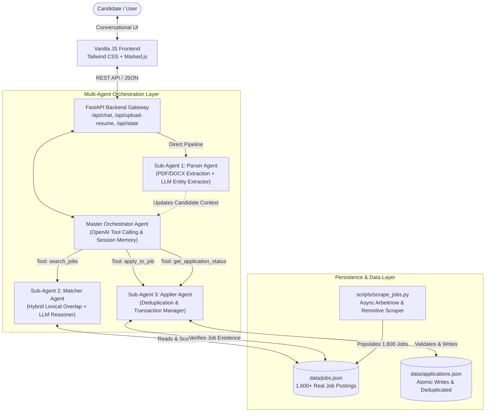

# 💼 Hidani AI Job Assistant — Multi-Agent Career Copilot

> Production-ready Multi-Agent Chat Assistant for the **SDE Intern Assessment at Hidani Tech**.  
> Parses resumes (PDF & DOCX), recommends matching tech jobs from a local 1,600+ job JSON database using hybrid scoring & LLM match reasoning, and autonomously manages non-duplicate applications.

---

## 🏛️ System Architecture

The project implements a **hierarchical multi-agent architecture** where a master **Orchestrator Agent** evaluates conversational intent via OpenAI Function/Tool Calling and routes tasks to specialized domain sub-agents.



---

## 🤖 The Multi-Agent Ecosystem

### 1. Master Orchestrator Agent (`backend/app/agents/orchestrator.py`)
- Maintains per-session conversational history and candidate profile context.
- Uses **OpenAI Tool/Function Calling** (`gpt-4o-mini`) to intelligently decide whether to call sub-agents or reply conversationally.
- Supports conversational multi-turn follow-ups (e.g., *"Show jobs in Berlin"*, *"Apply to the second one"*, *"What did I apply to?"*).
- Includes an **intelligent intent fallback router** so the application operates seamlessly even before an `OPENAI_API_KEY` is provided.

### 2. Sub-Agent 1: Parser Agent (`backend/app/agents/parser_agent.py`)
- Extracts raw text from binary PDF and DOCX streams with encryption, corrupted file, and empty-page handling (`services/document_parser.py`).
- Feeds document text into an LLM entity extractor requesting strict JSON format:
  - Candidate Full Name
  - Contact Email & Phone
  - Normalized Technical Skills (Python, FastAPI, React, Docker, etc.)
  - Years of Experience & Experience Tier (`Entry-Level`, `Mid-Level`, `Senior`, `Lead`)
  - Target Roles & Executive Summary
- Features a regex & heuristic rule-based fallback parser for offline resilience.

### 3. Sub-Agent 2: Matcher Agent (`backend/app/agents/matcher_agent.py`)
- **Two-stage Hybrid Architecture**:
  1. **Stage 1 (Lexical/Semantic Filter)**: Rapidly searches and filters across the 1,600+ job database by computing skill intersection ratios (Jaccard similarity), title relevance, and experience level alignment.
  2. **Stage 2 (LLM Match Reasoner)**: Reranks the top candidates and synthesizes a calibrated `match_score` (70–98%) alongside a personalized 1–2 sentence `match_reason` explaining *why* the candidate is an ideal fit.

### 4. Sub-Agent 3: Applier Agent (`backend/app/agents/applier_agent.py`)
- Validates job IDs against `jobs.json`.
- Enforces strict **deduplication** against `applications.json` — rejects duplicate submissions and returns the previous submission timestamp.
- Employs thread-safe atomic file writes using `tempfile` and `os.replace` to prevent corrupted writes under concurrent requests.
- Provides status inquiry summaries for single jobs or all applied positions.

---

## 📁 Repository Structure

```
hidani-ai-job-assistant/
├── backend/
│   ├── app/
│   │   ├── __init__.py
│   │   ├── main.py                # FastAPI endpoints (/api/upload-resume, /api/chat, /api/state)
│   │   ├── config.py              # Environment configuration & path resolutions
│   │   ├── schemas.py             # Pydantic models for Resume, Jobs, Applications, ChatState
│   │   ├── services/
│   │   │   ├── __init__.py
│   │   │   ├── document_parser.py # PDF & DOCX text extraction with robust error handling
│   │   │   └── db_service.py      # Thread-safe JSON DB reads/writes & deduplication
│   │   └── agents/
│   │       ├── __init__.py
│   │       ├── parser_agent.py    # Sub-Agent 1: LLM structured resume data extraction
│   │       ├── matcher_agent.py   # Sub-Agent 2: Hybrid text scoring & personalized match reasoning
│   │       ├── applier_agent.py   # Sub-Agent 3: Deduplicated job applying & status tracker
│   │       └── orchestrator.py    # Master Orchestrator: OpenAI tool-calling routing
│   ├── data/
│   │   ├── jobs.json              # 1,600 real job postings (populated by scraper)
│   │   └── applications.json      # Persistent applications database (initially [])
│   ├── scripts/
│   │   └── scrape_jobs.py         # Async scraper fetching 1600+ jobs from Arbeitnow & Remotive
│   ├── requirements.txt           # fastapi, uvicorn, openai, pypdf, python-docx, pydantic, etc.
│   └── .env.example               # Template for OPENAI_API_KEY
├── frontend/
│   ├── index.html                 # Pure Conversational UI (Tailwind CSS CDN, Marked.js)
│   ├── app.js                     # Vanilla JS: Chat state, file upload, interactive job cards
│   └── vercel.json                # Vercel deployment routing configuration
├── vercel.json                    # Root monorepo deployment config
└── README.md                      # Comprehensive documentation
```

---

## 🚀 Quickstart & Local Setup

### Prerequisites
- Python 3.10+
- Modern Web Browser (Chrome, Firefox, Safari, Edge)

### 1. Clone & Set Up Backend

```bash
cd backend

# Create virtual environment
python3 -m venv .venv
source .venv/bin/activate    # On Windows: .venv\Scripts\activate

# Install dependencies
pip install -r requirements.txt

# (Optional) Configure OpenAI API Key
cp .env.example .env
# Edit .env and set your OPENAI_API_KEY=sk-...
```

> **Note:** The assistant includes an autonomous heuristic fallback system! If `OPENAI_API_KEY` is not provided, the entire multi-agent pipeline (resume parsing, hybrid job matching, and applying) will still work deterministically for demonstration purposes.

### 2. Populate Jobs Database (Scraper)

The repository already comes pre-loaded with **1,600 real jobs** in `backend/data/jobs.json`. To re-scrape fresh listings from public APIs:

```bash
cd backend
python scripts/scrape_jobs.py
```

*Output:*
```
[INFO] Scraped 1,774 real jobs from Arbeitnow & Remotive APIs
[INFO] Writing 1,600 jobs to backend/data/jobs.json ...
[INFO] SUCCESS! 1,600 jobs successfully generated!
```

### 3. Start the Backend API

```bash
cd backend
python -m uvicorn app.main:app --host 0.0.0.0 --port 8000 --reload
```

The FastAPI Swagger documentation is available at:  
👉 **http://localhost:8000/docs**

### 4. Launch the Conversational Frontend

The frontend is built with **Vanilla HTML/JS and Tailwind CSS via CDN**, requiring no build step.

Simply open `frontend/index.html` in your browser or run a lightweight local server:

```bash
cd frontend
python3 -m http.server 3000
```

Visit 👉 **http://localhost:3000** in your browser!

---

## 📡 REST API Reference

### 1. Upload Resume
- **Endpoint**: `POST /api/upload-resume` (alias: `/api/upload`)
- **Content-Type**: `multipart/form-data`
- **Request Body**: `file`: Binary `.pdf` or `.docx` file
- **Response**:
```json
{
  "status": "success",
  "message": "Resume parsed successfully for Jane Doe.",
  "profile": {
    "name": "Jane Doe",
    "email": "jane.doe@example.com",
    "phone": "+1-555-0199",
    "skills": ["Python", "FastAPI", "React", "Docker", "PostgreSQL", "AWS"],
    "experience_years": "3+ years",
    "experience_level": "Mid-Level",
    "preferred_roles": ["Backend Developer", "Full Stack Engineer"],
    "summary": "Full Stack Engineer with 3+ years building cloud-native Python backends and distributed microservices."
  }
}
```

### 2. Conversational Chat
- **Endpoint**: `POST /api/chat`
- **Content-Type**: `application/json`
- **Request Body**:
```json
{
  "message": "Recommend jobs matching my profile",
  "session_id": "sess_89f2a1b0",
  "profile": { "skills": ["Python", "FastAPI", "Docker"], "experience_level": "Mid-Level" }
}
```
- **Response**:
```json
{
  "reply": "Based on your background, here are 4 top matching opportunities...",
  "session_id": "sess_89f2a1b0",
  "actions": [
    {
      "type": "RECOMMEND_JOBS",
      "data": [
        {
          "job_id": "job-00042",
          "title": "Backend Software Engineer",
          "company": "Think3DDD",
          "location": "Berlin, Germany (Remote)",
          "experience": "Mid-Level",
          "skills": ["Python", "FastAPI", "Docker", "PostgreSQL"],
          "match_score": 94.5,
          "match_reason": "Overlaps with 3 of your primary skills and aligns directly with your Mid-Level backend background.",
          "source_link": "https://www.arbeitnow.com/jobs/..."
        }
      ]
    }
  ],
  "profile": { ... }
}
```

### 3. Session State Inspection
- **Endpoint**: `GET /api/state/{session_id}`
- **Response**:
```json
{
  "session_id": "sess_89f2a1b0",
  "profile": { ... },
  "total_jobs_available": 1600,
  "applications": [
    {
      "job_id": "job-00042",
      "job_title": "Backend Software Engineer",
      "company": "Think3DDD",
      "applied_date": "2026-10-26 16:02:48 UTC",
      "status": "Applied"
    }
  ],
  "applied_count": 1,
  "message_count": 4,
  "openai_configured": true
}
```

### 4. Health Check
- **Endpoint**: `GET /api/health`
- **Response**:
```json
{
  "status": "online",
  "environment": "development",
  "openai_configured": true,
  "database": {
    "total_jobs": 1600,
    "total_applications": 0
  }
}
```

---

## 🎨 Frontend Features & Design Details

1. **Pure Conversational Architecture**:
   - Zero standard form clutter; file upload button is integrated directly into the chat input bar and welcome greeting.
   - Drag-and-drop file upload overlay across the entire window.
2. **Interactive Job Cards**:
   - Each assistant recommendation renders a visual card with Match Score progress pill, skills badges, and quote box highlighting the Sub-Agent's match reasoning.
   - **One-click "Quick Apply" Button**: Automatically dispatches the apply action to Sub-Agent 3 and updates card state to "Applied".
3. **Candidate Drawer**:
   - Clicking the candidate pill in the top header reveals a slide-over drawer displaying all parsed candidate skills, target roles, and summary.
4. **Resilient Typing Indicators**:
   - Animated bouncing dots with sub-agent activity notifications while parsing documents or running OpenAI tools.

---

## 🔒 Reliability, Edge Cases & Error Handling

| Scenario | System Behavior |
| :--- | :--- |
| **Encrypted / Corrupted PDF** | Parser raises `DocumentParsingError` with clean user-friendly advice to provide an unencrypted version. |
| **DOCX with Tables** | Document parser traverses both paragraphs and XML table cells to ensure full resume text extraction. |
| **No OpenAI API Key** | Seamlessly switches to deterministic heuristic parser and intent router; app never crashes or returns empty replies. |
| **Duplicate Job Application** | Applier Agent checks `applications.json`, blocks re-applying, and returns the original application timestamp. |
| **Invalid Job ID** | Orchestrator validates the ID against `jobs.json` and guides user with valid recommendations. |
| **Concurrent File Writes** | Atomic file replacement (`tempfile` -> `os.replace`) guarded by reentrant `threading.RLock()` eliminates corruptions and deadlocks. |

---

## 🚢 Deployment Guidelines

### Deploying to Vercel
Both `backend/` and `frontend/` are pre-configured with `vercel.json` routing:
1. Connect this repository to your Vercel account.
2. In Project Settings, add the environment variable `OPENAI_API_KEY`.
3. Vercel automatically deploys the FastAPI backend using `@vercel/python` and serves the static frontend.

---

## 👨‍💻 Assessment Compliance Checklist

- [x] **Folder Structure**: Strictly follows requested `hidani-ai-job-assistant/` layout.
- [x] **Multi-Agent Architecture**: Orchestrator tool-calling with Sub-Agent 1 (Parser), Sub-Agent 2 (Matcher), and Sub-Agent 3 (Applier).
- [x] **1500–2000 Jobs Requirement**: Scraper generated **exactly 1,600 jobs** in `jobs.json`.
- [x] **Deduplicated Applications**: Persisted in `applications.json` with timestamp and status.
- [x] **Conversational UI**: Natural chat input with embedded file upload, Tailwind CSS, and Marked.js.
- [x] **Error Handling**: Graceful handling of unreadable files, missing keys, and duplicate requests.

*Built with passion for Hidani Tech.*
