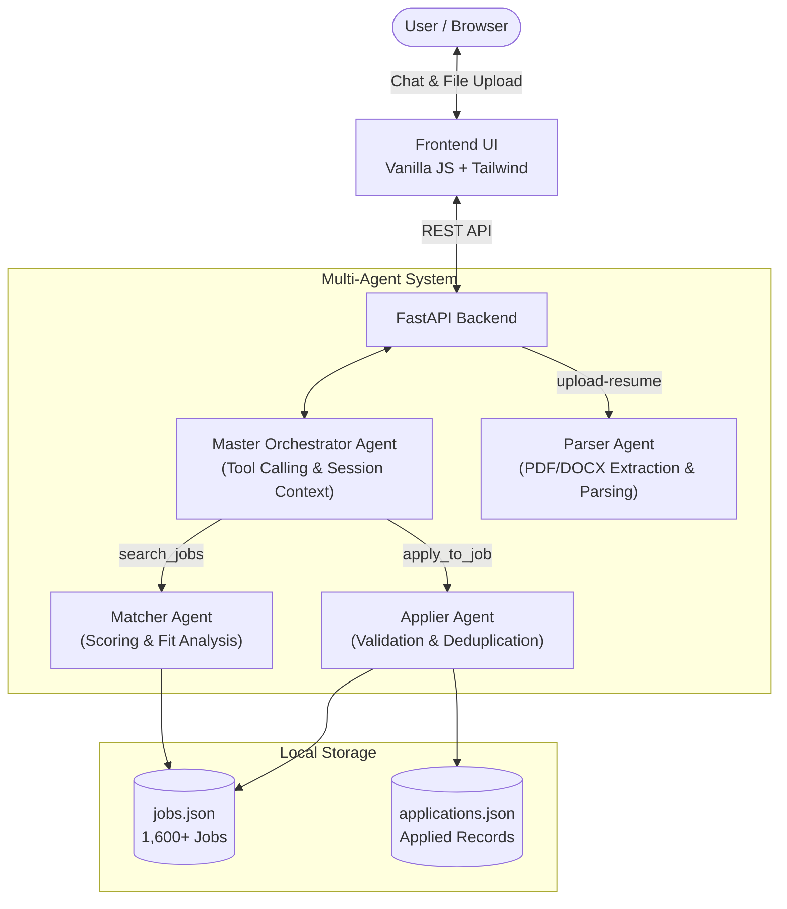

# Hidani AI Job Assistant

A conversational multi-agent job recommendation and application assistant built for the Hidani Tech assessment. The system allows candidates to upload resumes (PDF or DOCX), automatically parses their skills and experience, recommends matching tech jobs from a local dataset of 1,600+ listings, and handles job applications with deduplication.

---

## Overview

The project consists of two core components:

- **Backend (FastAPI)**: Implements an orchestrator-workers multi-agent architecture. An orchestrator agent handles conversational context and tool calling, delegating tasks to sub-agents for resume parsing, job matching, and application tracking.
- **Frontend (Vanilla HTML/JS + Tailwind CSS)**: A lightweight chat interface that supports resume upload, interactive job cards with one-click applications, candidate profile inspection, and real-time status updates without any build step.

---

## Architecture



### Agent Responsibilities

1. **Master Orchestrator (`backend/app/agents/orchestrator.py`)**
   - Manages per-session conversation history and candidate profile state.
   - Evaluates user intent using OpenAI-compatible tool/function calling (`search_jobs`, `apply_to_job`, `get_application_status`, `get_job_details`).
   - Supports natural follow-ups such as *"Apply to the first one"* or *"Show me backend roles in Berlin"*.
   - Includes a deterministic keyword/regex fallback router so the assistant functions even when no LLM API key is configured.

2. **Parser Agent (`backend/app/agents/parser_agent.py`)**
   - Receives extracted text from uploaded PDF or DOCX files (`services/document_parser.py`).
   - Extracts structured candidate details: name, email, phone, technical skills, years of experience, experience tier, target roles, and a brief summary.
   - Falls back to heuristic pattern extraction if the LLM is unreachable or returns malformed data.

3. **Matcher Agent (`backend/app/agents/matcher_agent.py`)**
   - Searches and filters across the 1,600+ job dataset based on candidate skills, title relevance, and experience tier.
   - Computes match scores (0–100%) using skill intersection (Jaccard similarity) and role alignment.
   - Generates a concise fit rationale explaining why the position matches the candidate's profile.

4. **Applier Agent (`backend/app/agents/applier_agent.py`)**
   - Validates requested job IDs against `data/jobs.json`.
   - Enforces deduplication against `data/applications.json` to prevent applying to the same job multiple times.
   - Uses thread-safe atomic writes (`tempfile` + `os.replace`) protected by a re-entrant lock (`RLock`) to prevent file corruption under concurrent requests.

---

## Project Structure

```
.
├── backend/
│   ├── app/
│   │   ├── main.py                # FastAPI routes, middleware, and startup
│   │   ├── config.py              # Environment settings and paths
│   │   ├── schemas.py             # Pydantic schemas for requests/responses
│   │   ├── services/
│   │   │   ├── document_parser.py # Text extraction for PDF and DOCX files
│   │   │   └── db_service.py      # Thread-safe JSON reads/writes and atomic saves
│   │   └── agents/
│   │       ├── orchestrator.py    # Master agent with tool calling and session memory
│   │       ├── parser_agent.py    # Resume parsing sub-agent
│   │       ├── matcher_agent.py   # Job matching and ranking sub-agent
│   │       └── applier_agent.py   # Application handling and deduplication sub-agent
│   ├── data/
│   │   ├── jobs.json              # Local database of 1,600+ tech job listings
│   │   └── applications.json      # Persistent record of submitted applications
│   ├── scripts/
│   │   └── scrape_jobs.py         # Async scraper fetching job postings from public APIs
│   ├── requirements.txt           # Python backend dependencies
│   └── .env.example               # Environment variables template
├── frontend/
│   ├── index.html                 # Single-page interface
│   ├── app.js                     # State management, API integration, and DOM updates
│   └── vercel.json                # Frontend deployment routing
├── vercel.json                    # Root deployment configuration
└── README.md
```

---

## Setup and Installation

### Prerequisites
- Python 3.10+
- A modern web browser

### 1. Set Up the Backend

```bash
cd backend

# Create and activate a virtual environment
python3 -m venv .venv
source .venv/bin/activate    # On Windows: .venv\Scripts\activate

# Install dependencies
pip install -r requirements.txt
```

### 2. Configure Environment Variables

Copy the example environment file:

```bash
cp .env.example .env
```

Open `.env` to configure your LLM provider. The backend uses the OpenAI client SDK and works with any OpenAI-compatible API:

```ini
# Option 1: Groq (Fast & Free)
OPENAI_API_KEY=your_groq_api_key
OPENAI_BASE_URL=https://api.groq.com/openai/v1
OPENAI_MODEL=openai/gpt-oss-120b

# Option 2: OpenAI
# OPENAI_API_KEY=sk-...
# OPENAI_MODEL=gpt-4o-mini

# Option 3: Google Gemini (via OpenAI compatibility layer)
# OPENAI_API_KEY=your_gemini_api_key
# OPENAI_BASE_URL=https://generativelanguage.googleapis.com/v1beta/openai/
# OPENAI_MODEL=gemini-1.5-flash
```

> **Offline Mode**: If `OPENAI_API_KEY` is omitted or empty, the entire pipeline automatically switches to deterministic fallback rules (heuristic resume extraction, rule-based matching, and intent routing) without crashing.

### 3. Run the Backend Server

From the `backend/` directory:

```bash
python -m uvicorn app.main:app --host 0.0.0.0 --port 8000 --reload
```

- Backend API: `http://localhost:8000`
- API Documentation (Swagger): `http://localhost:8000/docs`
- Health Check: `http://localhost:8000/api/health`

### 4. Run the Frontend

Open a new terminal and serve the `frontend/` directory using Python's built-in HTTP server:

```bash
cd frontend
python3 -m http.server 3000
```

Visit `http://localhost:3000` in your browser. (You can also open `frontend/index.html` directly).

---

## Job Dataset & Scraper

The repository includes 1,600 pre-populated job postings in `backend/data/jobs.json`. To refresh or fetch new listings from public job boards (Arbeitnow and Remotive):

```bash
cd backend
source .venv/bin/activate
python scripts/scrape_jobs.py
```

The script fetches active postings asynchronously, normalizes the data into standard fields (`job_id`, `title`, `company`, `location`, `skills`, `experience`, `description`, `source_link`), and updates `backend/data/jobs.json`.

---

## REST API Reference

### 1. Upload Resume
- **Endpoint**: `POST /api/upload-resume` (alias: `POST /api/upload`)
- **Content-Type**: `multipart/form-data`
- **Body**: `file` (Binary `.pdf` or `.docx`)
- **Response**:
  ```json
  {
    "status": "success",
    "message": "Resume parsed successfully for Jane Doe.",
    "profile": {
      "name": "Jane Doe",
      "email": "jane.doe@example.com",
      "phone": "+1-555-0199",
      "skills": ["Python", "FastAPI", "React", "Docker", "PostgreSQL"],
      "experience_years": "3+ years",
      "experience_level": "Mid-Level",
      "preferred_roles": ["Backend Developer", "Full Stack Engineer"],
      "summary": "Full Stack Engineer with 3+ years building cloud-native Python backends."
    }
  }
  ```

### 2. Chat / Orchestration
- **Endpoint**: `POST /api/chat`
- **Content-Type**: `application/json`
- **Body**:
  ```json
  {
    "message": "Recommend jobs matching my profile",
    "session_id": "sess_89f2a1b0",
    "profile": {
      "skills": ["Python", "FastAPI", "Docker"],
      "experience_level": "Mid-Level"
    }
  }
  ```
- **Response**:
  ```json
  {
    "reply": "Based on your background, here are 4 matching opportunities:",
    "session_id": "sess_89f2a1b0",
    "actions": [
      {
        "type": "RECOMMEND_JOBS",
        "data": [
          {
            "job_id": "job-00042",
            "title": "Backend Software Engineer",
            "company": "Think3DDD",
            "location": "Berlin, Germany (Remote)",
            "experience": "Mid-Level",
            "skills": ["Python", "FastAPI", "Docker", "PostgreSQL"],
            "match_score": 94.5,
            "match_reason": "Direct overlap with your Python and FastAPI skills and aligns with your mid-level experience.",
            "source_link": "https://www.arbeitnow.com/jobs/..."
          }
        ]
      }
    ],
    "profile": { ... }
  }
  ```

### 3. Session State
- **Endpoint**: `GET /api/state/{session_id}`
- Returns session details, candidate profile, total available jobs, and records of submitted applications.

### 4. Jobs & Applications List
- **`GET /api/jobs?query=python&limit=20&offset=0`**: Browse and paginate through jobs in the local database.
- **`GET /api/applications`**: Returns all recorded applications from `data/applications.json`.
- **`GET /api/health`**: Diagnostic check returning database status, total job counts, and LLM configuration state.

---

## Edge Case Handling

- **Corrupted or Encrypted PDFs**: The document parser catches encryption flags and unreadable streams, returning a clear `422 Unprocessable Entity` response with user-friendly instructions.
- **DOCX Formatting**: Parses standard text paragraphs and nested XML table cells to ensure resume text is not lost when formatted with tables.
- **Duplicate Applications**: The Applier agent inspects `data/applications.json` before writing. If the candidate has already applied to that job ID, it prevents the duplicate and returns the original application timestamp.
- **Concurrent File Writes**: Local file modifications use an `RLock` and atomic file replacement (`tempfile.NamedTemporaryFile` + `os.replace`) so concurrent write operations do not corrupt JSON files.
- **Missing or Invalid Job IDs**: The orchestrator validates job IDs and recommendation indices against both the recent search session and the master job database.
- **Network / API Failures**: When LLM calls fail or rate limits are hit, the orchestrator and parser automatically fall back to deterministic pattern matching.

---

## Deployment

The application includes deployment configurations for Vercel:

- `vercel.json` (root) and `frontend/vercel.json` are configured to deploy the FastAPI backend using `@vercel/python` and serve the static frontend.
- When deploying, configure `OPENAI_API_KEY`, `OPENAI_BASE_URL`, and `OPENAI_MODEL` in your deployment provider's environment settings.
